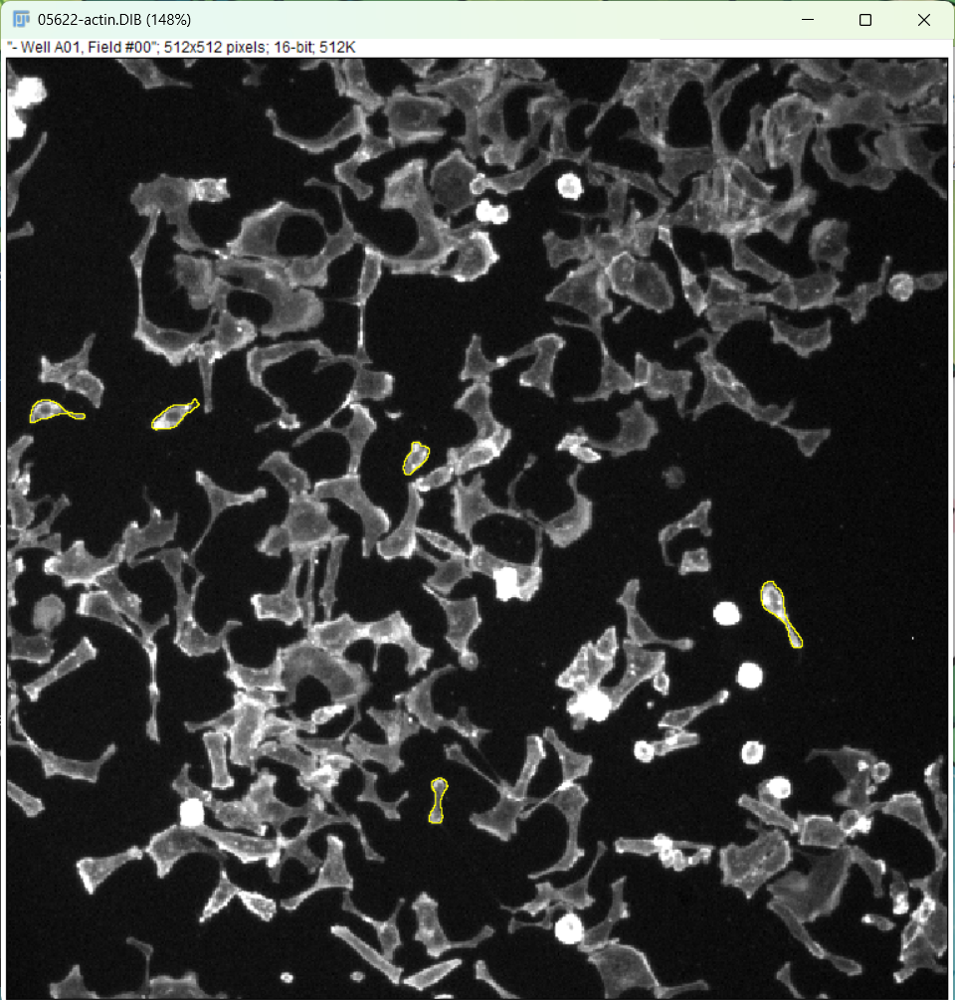
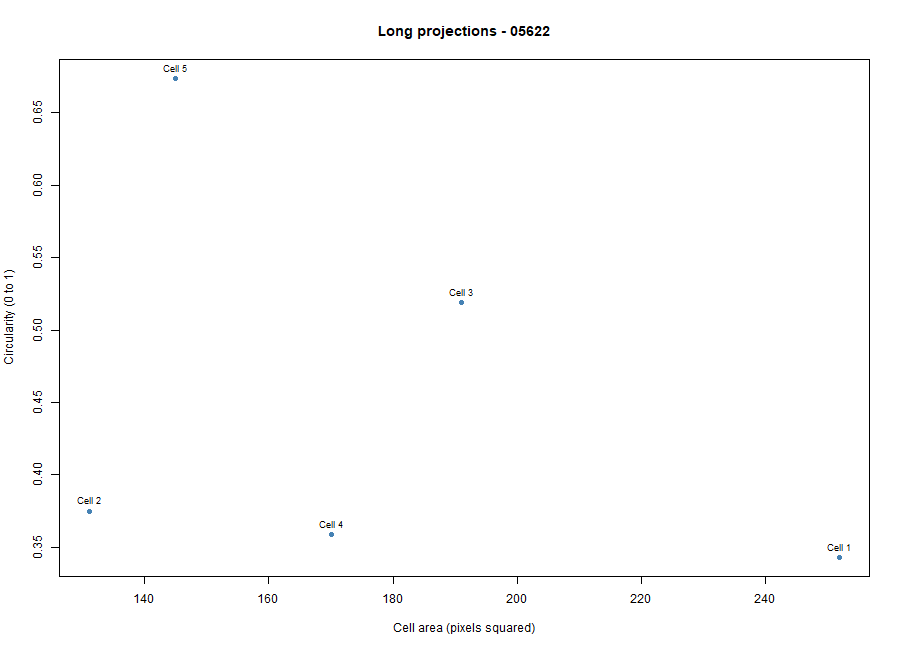
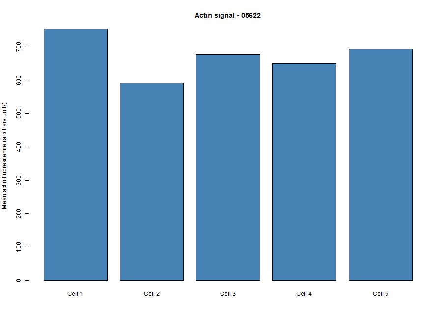

# Cytoskeleton and Cell Morphology – BBBC018

## Student Information

- **Student Name:** Deguit, Zenas Charis C.
- **Image Field ID:** 05622
- **Chosen Phenotype:** Long projections (visual classification)
- **Actin Filename:** 05622-actin.DIB
- **DNA Filename:** 05622-DNA.DIB
- **Dataset:** BBBC018v1 – HT29 human colon cancer cells
- **Software Used:** Fiji/ImageJ and RStudio

## 1. Introduction

The cytoskeleton is important in maintaining cell shape, providing structural support, and allowing cells to move. Actin filaments are components of the cytoskeleton that help cells maintain their structure and form extensions.

This laboratory activity aimed to examine the morphology and F-actin staining patterns of HT29 human colon cancer cells using fluorescence microscopy images from the BBBC018 dataset. Five cells were measured using Fiji/ImageJ, and the results were analyzed using RStudio.

## 2. Dataset Information

The fluorescence images were obtained from the Broad Bioimage Benchmark Collection (BBBC018v1).

- **Dataset Link:** https://bbbc.broadinstitute.org/BBBC018
- **Direct Download:** https://data.broadinstitute.org/bbbc/BBBC018/BBBC018_v1_images.zip
- **Selected Image Field:** 05622

The actin fluorescence channel was used to observe cell shape and F-actin staining, while the DNA channel helped identify the nuclei. The selected phenotype was visually classified as Long projections based on the presence of thin cellular extensions.

## 3. Methodology

### A. Fiji/ImageJ Analysis

1. Downloaded and extracted the BBBC018v1 image dataset.
2. Opened `05622-actin.DIB` and examined the matching `05622-DNA.DIB` image.
3. Observed the cell morphology and identified the phenotype as Long projections.
4. Selected five cells using the Freehand Selection tool.
5. Added the selected regions to the ROI Manager.
6. Used Analyze > Set Measurements to record area, mean gray value, and shape descriptors.
7. Measured the cell area, mean actin fluorescence intensity, circularity, and aspect ratio.
8. Saved the results as `data/fiji_results.csv` and the annotated image as `figures/measured_cells.png`.

### B. RStudio Analysis

1. Imported the Fiji measurements from `data/fiji_results.csv`.
2. Checked the required measurements and calculated their mean values.
3. Saved the numerical summary as `results/cell_summary.csv`.
4. Generated a scatter plot comparing cell area and circularity.
5. Generated a bar graph showing the mean actin fluorescence intensity of the five cells.
6. Saved the R script as `scripts/analyze_cells.R`.

## 4. Results and Figure Descriptions

Five cells were measured from image field 05622.

| Measurement | Mean Value |
|---|---:|
| Cell Area | 177.8 pixels² |
| Circularity | 0.454 |
| Aspect Ratio | 3.213 |
| Mean Actin Fluorescence Intensity | 673.3 arbitrary units |

### Figure 1. Measured Cells in Fiji/ImageJ

**Description:** The image shows the selected cell regions outlined in yellow using Fiji/ImageJ. The cells have irregular shapes, and several surrounding cells display thin extensions. These visible features support the tentative classification of Long projections.

### Figure 2. Cell Area versus Circularity

**Description:** The scatter plot compares cell area and circularity among the five measured cells. Cell areas ranged from 131 to 252 pixels², while circularity ranged from 0.343 to 0.674. These differences indicate variation in cell size and shape.

### Figure 3. Mean Actin Fluorescence Intensity

**Description:** The bar graph presents the mean actin fluorescence intensity of each measured cell. Cell 1 had the highest intensity (753.774), while Cell 2 had the lowest (591.305). This shows that the recorded F-actin staining signal varied among the selected cells.

## 5. Discussion Questions

### 1. Which specific phenotype did you choose, and what visible features support that choice?

The selected phenotype was classified as Long projections because several cells showed thin, elongated extensions extending from their cell bodies. The irregular shapes and visible projections supported this visual classification.

### 2. Were your five cells mostly round or elongated? Refer to your circularity and aspect-ratio results.

The five measured cells were mostly elongated rather than round. Their mean circularity was 0.454, while their mean aspect ratio was 3.213, indicating that the measured cell regions were generally longer than they were wide.

### 3. What role does actin play in maintaining cell shape and in cell movement (Karp Chapter 9)?

Actin filaments provide structural support and help maintain cell shape by forming part of the cytoskeleton. They also contribute to cell movement by supporting membrane extensions and interacting with myosin to generate force.

### 4. Why can a single fixed fluorescence image NOT show how fast a cell moves?

A single fixed fluorescence image only shows the cells at one point in time. Since cell movement requires changes in position over time, a single image cannot determine how fast a cell moves.

## 6. Conclusion

This laboratory activity demonstrated how Fiji/ImageJ and RStudio can be used to examine cell morphology and F-actin staining patterns. The five measured cells had a mean circularity of 0.454 and a mean aspect ratio of 3.213, indicating that they were generally elongated or irregular rather than round.

The results also showed differences in cell area and mean actin fluorescence intensity, suggesting variation in cell morphology and staining patterns. Overall, the activity helped demonstrate the structural role of actin in maintaining cell shape and supporting cellular extensions. However, actual cell movement and migration speed could not be determined because the fluorescence images represented fixed cells.

## 7. Repository Contents

- `data/fiji_results.csv` – Fiji measurements of five cells
- `scripts/analyze_cells.R` – R analysis script
- `results/cell_summary.csv` – Numerical summary of measurements
- `figures/measured_cells.png` – Annotated fluorescence image
- `figures/area_vs_circularity.png` – Cell area versus circularity scatter plot
- `figures/actin_intensity.png` – Mean actin fluorescence intensity bar graph
- `README.md` – Laboratory documentation and discussion

## 8. Data Credit and Attribution

We used image set BBBC018v1 from the Broad Bioimage Benchmark Collection (Ljosa et al., Nature Methods, 2012).

**Dataset:** https://bbbc.broadinstitute.org/BBBC018

**Image License:** CC BY-NC-SA 3.0
